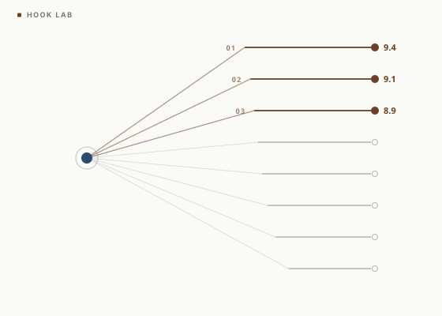

# Hook Lab

**Test a LinkedIn hook 20 ways with a 5-persona AI jury.**

<p align="center">
  
</p>

Hook Lab takes your rough hook idea, generates 20 meaningfully different variations using 8 rewrite strategies, then deploys 5 AI personas to score them independently. You get a ranked leaderboard by scroll-stop power, curiosity gap, specificity, emotional pull, and brand alignment — plus accumulated learning across runs.

---

## What is Claude Code?

Claude Code is Anthropic's free CLI that runs Claude directly in your terminal. Hook Lab is a **plugin** for Claude Code — install it once and it's available from any project.

[Install Claude Code](https://docs.anthropic.com/claude/claude-code) — takes about 2 minutes.

---

## Install

Two ways. Pick whichever you trust more.

### Option 1 — Plugin install (recommended, one command)

Inside Claude Code (type these in the Claude Code chat, not a separate terminal):

```
/plugin install hook-lab --marketplace JuanMinoprio/hook-lab
```

On Claude Code older than 2.1.275, use two steps instead:

```
/plugin marketplace add JuanMinoprio/hook-lab
/plugin install hook-lab@hook-lab
```

To update later: `/plugin update hook-lab@hook-lab`

### Option 2 — Manual install (inspect the source first)

If you want to read every file before anything touches your machine:

```bash
git clone https://github.com/JuanMinoprio/hook-lab.git
cd hook-lab

# Copy the skill into your personal Claude Code directory
mkdir -p ~/.claude/skills/hook-lab
cp plugins/hook-lab/skills/hook-lab/SKILL.md ~/.claude/skills/hook-lab/
cp plugins/hook-lab/skills/hook-lab/config.default.md ~/.claude/skills/hook-lab/
```

Then restart Claude Code. The skill will load from your user directory.

---

## Usage

```
/hook-lab:hook-lab Your hook text here
```

> **Why the colon?** Plugin commands use the format `/plugin-name:skill-name`. Since this plugin has one skill, the name repeats. Just type it as shown.

**First run** uses bundled defaults (LinkedIn, 5 standard personas) — no setup needed. A typical run takes about 60 seconds.

**To personalize** (recommended after your first run):

```
/hook-lab:hook-lab setup
```

This walks you through 5 questions and generates an AI jury tuned to **your** specific audience, voice, and platform. Personalized juries consistently outperform generic ones.

---

## What It Does

1. **Parses your hook** and detects the content pillar
2. **Generates 20 variations** using 8 rewrite strategies:
   - Specificity swap (vague → concrete)
   - Format flip (statement ↔ question)
   - Data injection (add a surprising number)
   - Contrarian inversion (flip the claim)
   - Story-led rewrite (drop into a scene)
   - Emotional amplifier (raise urgency/awe)
   - Length compression (6–10 word punchy version)
   - Audience shift (narrow the "you")
3. **Launches a 5-persona jury** in parallel — each persona scores all hooks independently with randomized order to prevent bias
4. **Aggregates scores** across 5 dimensions, ranks the top 10. Hooks that split the jury (some love it, some don't) get a bonus — polarizing hooks often stop more scrolls than safe ones.
5. **Learns over time** — tracks which strategies win for your audience and weights future runs accordingly

See [`plugins/hook-lab/examples/example-run.md`](./plugins/hook-lab/examples/example-run.md) for an annotated run.

---

## Output Format

```
HOOK LAB RESULTS — [pillar]
Tested: 20 variations + original | Jury: 5 personas | Platform: LinkedIn

WINNER (#12): "83% of marketers say they test hooks. Here's what the 17% who don't know that the 83% don't."
  Score: 8.4/10 | Strategy: Data Injection
  Scroll-Stop: 8.8 | Curiosity: 9.1 | Specificity: 8.2 | Emotion: 7.9 | Brand: 7.5
  Click: 5/5 | Share: 3/5 | Consensus: 4/5 in top 5

TOP 10 LEADERBOARD
| Rank | Hook | Score | Strategy | Click | Share |

MUTATION INSIGHTS
- Data Injection produced 4 of the top 10 — audience responds to specificity signals
```

Results print directly in your Claude Code chat. Copy any hook straight from the output.

---

## Persona Setup

The opt-in `/hook-lab:hook-lab setup` flow asks 5 questions:

1. Your name
2. Primary platform (LinkedIn / X / Instagram / TikTok / Substack / YouTube)
3. Content pillars (up to 3 with rough % weights)
4. Your voice in one sentence
5. Your target audience (2–3 sentences)

From your audience description, Claude synthesizes 5 custom personas — each with a name, role, mindset, platform behavior, and the key question they ask themselves when scrolling.

Your personalized config is stored locally at `~/.claude/data/hook-lab/config.md`. Nothing is uploaded anywhere.

---

## FAQ

**How long does a run take?**
About 60 seconds. The jury scores all 20 variations in parallel.

**Does it cost money?**
Hook Lab itself is free. It runs on your Claude Code session, which uses your Anthropic API credits. Each run uses roughly 15–20K tokens.

**What if I don't like the winner?**
Run it again — you'll get different variations each time. The tool doesn't repeat the same rewrites.

**Can I test hooks I've already posted?**
Yes. Paste any hook and it will generate 20 new variations and score them all.

**Does it work for platforms other than LinkedIn?**
Setup lets you pick LinkedIn, X, Instagram, TikTok, Substack, or YouTube. The personas and scoring adapt to the platform you choose.

---

## Repo Structure

```
hook-lab/
├── .claude-plugin/
│   └── marketplace.json                — this repo's plugin registry
├── plugins/hook-lab/
│   ├── .claude-plugin/plugin.json      — plugin manifest
│   ├── skills/hook-lab/
│   │   ├── SKILL.md                    — the skill Claude runs
│   │   └── config.default.md           — bundled defaults for first run
│   └── examples/example-run.md         — annotated sample output
├── assets/
│   └── cover.svg                       — hero visual
├── README.md                           — this file
└── LICENSE                             — MIT
```

The structural rule for Claude Code plugins: `skills/` lives at the **plugin root**, not inside `.claude-plugin/`. Getting this wrong is the #1 footgun.

---

## Feedback

Built this because I was spending too long guessing which hook would land. Now I run every hook through the jury before I post.

If you try it, [open an issue](https://github.com/JuanMinoprio/hook-lab/issues) or [DM me on LinkedIn](https://www.linkedin.com/in/juanminoprio/).

---

## Privacy and secrets

Nothing here needs an API key, token, or account. The skill runs inside your own Claude Code session, and your personal config stays on your machine at `~/.claude/data/hook-lab/`. If you fork it and add an integration that does need a key, keep it in a local `.env` file: `.gitignore` already blocks `.env` files from being committed.

---

## Want this built for your team?

I'm Juan Minoprio. I build AI tools and workflows for marketing teams: systems like this one, scoped to your stack, your data, and your compliance rules.

**[Start a conversation](https://juanminoprio.com/?utm_source=github&utm_medium=readme&utm_campaign=hook-lab#contact)** or email hello@juanminoprio.com.

---

## License

MIT — see [LICENSE](./LICENSE).
